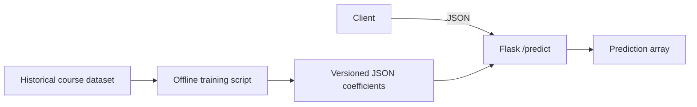

# Containerized ML inference API

A Udacity Cloud DevOps learning project demonstrating a Flask prediction API, Docker packaging, Kubernetes deployment, and automated API checks.

The maintained service uses Python 3.12 and a small JSON linear model trained reproducibly from the checked-in historical housing dataset. The original sklearn 0.20 pickle and old output logs remain as historical course artifacts; the service does not load that pickle. Predictions have changed from the historical model.

## What this demonstrates

- An application factory that loads and validates the model at startup.
- A stable JSON API supporting single requests, batches, and the original course column format.
- A training-only scaler folded into fixed coefficients: a prediction no longer changes depending on the other rows in a request.
- Input validation, health checks, bounded requests, and automated regression tests.
- A non-root container using Waitress; repeatable Kubernetes Deployment updates instead of duplicate pods.



## Run and test locally

Python 3.12 is the tested runtime.

```bash
python -m venv .venv
source .venv/bin/activate       # Windows: .venv\Scripts\Activate.ps1
python -m pip install -r requirements-dev.txt
python -m ruff check .
python -m pytest -q
python app.py
```

The server listens on port 8080 by default. Set PORT to change it. From a separate shell:

```bash
PORT=8080 bash make_prediction.sh
```

Expected response for the included sample, rounded here:

```json
{"prediction": [30.679328738467255]}
```

GET /health returns HTTP 200 with `{"status":"ok","model_version":1}` after the model loads. Importing `app:app` also loads the model, so WSGI execution and direct execution have the same behavior.

## API contract

POST /predict requires Content-Type: application/json and one to 100 rows:

```json
{
  "instances": [
    {"CHAS": 0, "RM": 6.575, "TAX": 296, "PTRATIO": 15.3, "B": 396.9, "LSTAT": 4.98}
  ]
}
```

Each row must contain exactly the six documented features with finite JSON numbers. Strings, booleans, missing/extra fields, unequal legacy column lengths, malformed JSON, and empty/oversized batches are rejected with a JSON error and HTTP 400. Wrong content type returns 415; requests over 64 KiB return 413.

The original format `{"CHAS":{"0":0}, "RM":{"0":6.575}, ...}` is also supported when every feature column has identical row keys. Response order follows input row order.

## Model and reproducibility

```bash
python -m pip install -r requirements-training.txt
python train_model.py
```

Training uses a fixed seed (42), 404 training rows and 102 held-out rows, with ordinary least squares. The artifact records the dataset SHA-256, NumPy version, coefficients, intercept and held-out RMSE. The local run on 18 September 2026 yielded RMSE **4.5881** in the dataset's historical target units (thousands of USD). This is a small educational baseline, not a current housing valuation model. The legacy feature names and historical dataset are retained for compatibility with the course.

The model file is reproducible to floating-point precision; different numerical libraries can produce insignificant rounding differences. The old output files describe the old implementation and are not evidence of current Docker/Kubernetes execution.

## Docker and Kubernetes

```bash
bash run_docker.sh
bash make_prediction.sh
```

The script builds `udacity-inference:local` and exposes localhost:8000 to container port 8080. Containers are removed on exit. To publish, first authenticate to a registry you own, then explicitly choose the image:

```bash
IMAGE=your-account/inference:v1 bash upload_docker.sh
```

For a configured test Kubernetes cluster, ensure the image is accessible and the namespace exists:

```bash
IMAGE=your-account/inference:v1 NAMESPACE=default bash run_kubernetes.sh
```

The script applies a named Deployment, waits up to 120 seconds for rollout, and forwards localhost:8000. Repeating it updates the same Deployment. Stop port-forwarding with Ctrl+C. Remove the demo when done:

```bash
kubectl delete deployment housing-inference --namespace=default
```

These commands create local containers or cluster resources only when explicitly run. CI does not publish images or deploy.

## Validation and provenance

On 18 September 2026, local verification passed **20 API tests** and Ruff checks with Python 3.12.14. CircleCI and [GitHub Actions](.github/workflows/validate.yml) install pinned test dependencies, lint, run the API tests, and store JUnit results. A remote green run is not claimed until those workflows execute.

Docker and Kubernetes execution were not verified during this cleanup because the local Docker daemon was unavailable. The image build, registry access, cluster permissions and rollout remain environment checks for an operator.

Based on Udacity's [DevOps Microservices course](https://github.com/udacity/DevOps_Microservices). The original course supplies the application concept and historical dataset/model. This repository's current operational work includes the container/Kubernetes scripts, validation, reproducible replacement model, and CI. See [change report](CHANGE_REPORT.md).
